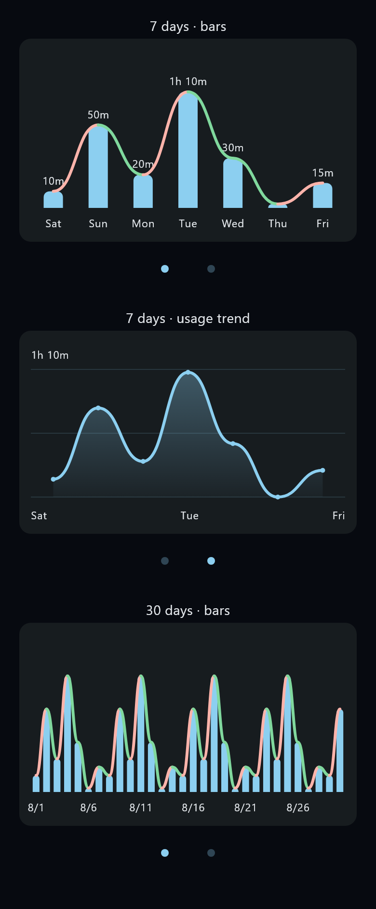

# App-detail charts

Open an app's usage details and swipe left over its bar chart to see a smooth
area chart for the same period. Swipe right to return, or tap either of the two
dots in the card's top-right corner. The range chip at the top left opens a
menu with the four ranges, and the range total sits under it. The filled dot identifies the current chart; the other remains partly
transparent. FocusTrace remembers the selected chart across detail screens and
app launches using the existing local SQLite settings store.

Both charts support 7 days, 2 weeks, 30 days, and 12 monthly totals. The bar chart
retains its usage columns and increase/decrease colors, with smooth curves over
the columns. Longer periods now fit the chart width, with fewer printed date
labels so that horizontal gestures always switch chart pages. Long-press or
hover over a point/column for its date and duration; those values are also
available to screen readers.

The preview below was rendered from the Flutter widgets with **sample data**;
it is not a recording of a user's usage or a physical-device screenshot.

## Month labels

The 30-day bar chart labels one day per week, counted back from the selected
day, with the month name (`Aug 2, Aug 9, ...`). It has no trend line, since thirty
thin columns do not carry a readable one. The other periods keep theirs.

## Usage calendar

Below the charts, the details screen shows:

- A stats row: total this month, average per day, app opens, and longest
  session. The first three show the change from last month. A month in progress
  is compared with the same days of the previous month, and the average per day
  counts only days that have already happened.
- A month calendar with previous/next arrows. You can't move past the current
  month. Each day is shaded in five legend buckets (<30m, 30m-1h, 1h-2h, 2h-3h,
  >3h). Neighbouring-month and future days are greyed, and the selected day uses
  the primary colour.
- A panel for the selected day: a ring filled relative to the month's busiest
  day, app opens, average session (time / opens), the change against the
  month's daily average, and a 24-hour timeline.

Productivity apps (by resolved category, so the per-app category override
applies) count as good. Their calendar runs dark to bright green instead of red,
and their trend line, yesterday badge and changes show more use as green.
Colours come from `trendColor` blended with the theme surface
(`usageHeatColor` in `trend_color.dart`), so no new palette is introduced.

Data comes from `ReportRepository.loadSourceData` for the shown month, the same
source the Reports screen uses. It gives daily totals, launch counts and
persisted foreground intervals (Android snapshot intervals; Windows sessions).
The previous month comes from the same source. Each month is loaded once per screen and kept in memory, and the month before the shown one is fetched in the background, because reconciling a month's history is the slow step. Switching to a loaded month is instant, and a month still loading keeps the current one on screen behind a thin progress bar. No schema,
migration, sync or dependency change was needed. When a day has no intervals,
the timeline says so and longest session shows `-`.

Code: [calendar view model](../lib/src/presentation/view_models/app_usage_calendar_view_model.dart),
[calendar widgets](../lib/src/presentation/widgets/usage_calendar.dart),
[tests](../test/app_usage_calendar_test.dart).

## Implementation and verification

- [Chart widgets](../lib/src/presentation/widgets/usage_details_charts.dart) own
  rendering, gestures, dot accessibility, and tooltips. The curves stay within
  neighboring values instead of implying an overshoot.
- The [ViewModel](../lib/src/presentation/view_models/app_usage_details_view_model.dart)
  owns chart selection and coordinates persistence through the existing settings
  repository. Delayed period loads cannot overwrite newer selections.
- [Widget tests](../test/usage_details_charts_test.dart) exercise swipes and dot
  navigation across every period, initial restoration, and zero-usage rendering.
  [State tests](../test/app_usage_details_view_model_test.dart) cover restored
  preferences, invalid settings, failed writes, rapid selection, and stale loads.
  The [app-flow test](../test/widget_test.dart) checks restoration after reopening
  the actual details route.
- Local verification: 93 Flutter tests passed, static analysis and formatting
  passed, and `flutter build apk --debug --no-pub` produced the debug APK.

Implements [issue #31](https://github.com/sneri12pic/FocusTrace/issues/31).
